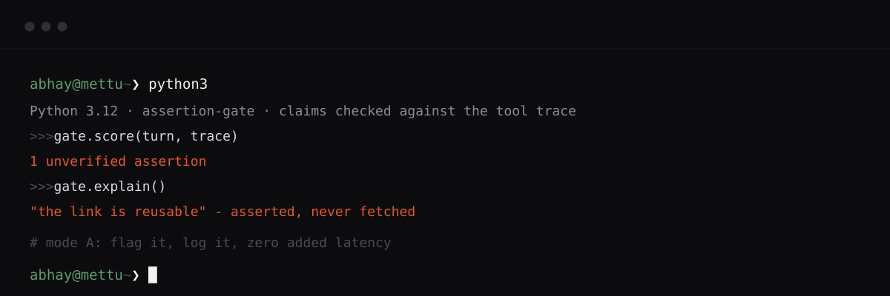

Computer science and economics from UW–Madison, May 2026. Machine learning
with data across all fields, and agent infrastructure that takes care of the
tedious parts. The interesting parts get measured and written up as research.

Reports with figures live at [abhaymettu.com](https://www.abhaymettu.com).
Ideas that outgrow a commit message turn into
[essays](https://www.abhaymettu.com/essays/).

Analyst and research roles where the job is to build the number and then find
out whether it holds. Washington State, Chicago, Boston or Madison WI, and I
will move.
[abhaymettu.com](https://www.abhaymettu.com) · abhaymettu12@gmail.com
